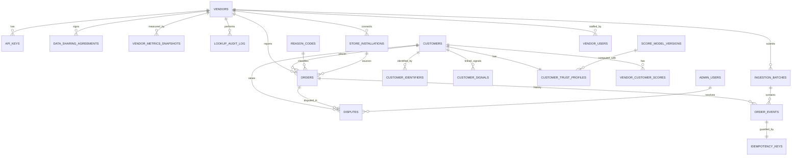

# Etimaad: System Blueprint v2: Cross-Vendor Customer Trust & Fulfillment Scoring Engine (MVP)

> **Status:** v2.11, 2026-11-23. It replaces the Gemini v1 blueprint and includes the v2 review fixes, the tech stack, the WooCommerce/Shopify connectors and the web surfaces (changelog in §21).
> **Market:** Pakistan (PKR, phone region +92).
> **Stack:** Next.js + TypeScript on Vercel (later), Supabase Postgres, Upstash Redis + QStash (§18).
> **Integrations:** REST API, WooCommerce plugin, Shopify app (§19).
> **Project name:** **Etimaad** (directory `E:\NIMAR\etimaad`, not created yet).
> **Still open:** legal counsel review, Shopify rule checks, SMS provider for the pilot (see §17).

---

## 0. What changed from v1 (summary)

| Area | v1 | v2 |
|---|---|---|
| Fault attribution | Vendor sends `fault_party` | Vendor sends `reason_code`; **server derives** `fault_party` from it. The vendor's own claim is stored separately for bias analysis. |
| Order model | One event row per outcome. Idempotency key = order + outcome. | `ORDERS` (current state, one row per vendor order) + `ORDER_EVENTS` (immutable history). Allowed state transitions and a correction window. |
| COD | Not modelled | `payment_method` on every order. Prepaid deliveries count as positive evidence, so customers have a way to recover. |
| Outcomes | DELIVERED / RETURNED / CANCELLED | Separate statuses for refusal at the door (RTO), post-delivery return, partial delivery, and cancellation stage. Added `UNKNOWN` and `NEUTRAL` fault classes. |
| Identity | Phone, email, address and device all merge identities | **Phone is the only identity key.** Email, address and device are non-merging signals. Phone recycling is handled through identity epochs. |
| Hashing | One salt | HMAC pepper kept in a secret manager, plus `key_version` and a rotation procedure. |
| Anti-poisoning | Fixed 85% blame threshold | Vendor KYC, probation, trust weight, bias measured against the category baseline, a corroboration rule, contribution caps and a backdating window. |
| Scoring | Undefined parameters | Exact formula with versioned parameters (`SCORE_MODEL_VERSIONS`), value bands, escalation for thin-data profiles, and a nightly decay recompute. |
| Governance | FLAGGED / SUSPENDED with no owner | Data-sharing agreement, per-order consent notice, `DISPUTES` table and process, audit logs, retention policy. |
| Lookup API | Open lookup | Audit log on every call, give-to-get quota, same response for unknown and thin-data customers, k-anonymity on network signals. |
| Keys | `api_key_hash` column on VENDORS | `API_KEYS` table (several keys per vendor, scopes, rotation, revocation) + HMAC request signing with replay protection. |

---

## 1. Objective & Scope

This is a B2B network for Pakistani COD merchants (food delivery, restaurants, e-commerce). Members:
1. Report **every** order outcome they have, not only failures.
2. Call a real-time **risk check** at checkout. It returns a risk tier and a recommended COD action.

Vendors connect in one of three ways (§19):
- the REST API directly;
- the **WooCommerce plugin**;
- the **Shopify app**.

The engine **recommends**. The vendor always makes the final decision.

**MVP goals**
- Correct, auditable, hard-to-game trust scores.
- Lookups at p99 < 100 ms.
- Idempotent ingestion through webhooks and batches.
- Privacy, consent and dispute handling from day one.

**Non-goals (v2)**
- ML scoring.
- Device fingerprinting as a risk input.
- Multi-branch vendor hierarchies.
- A self-service customer portal.
- Public vendor-reliability scores.

---

## 2. Legal & Governance (Pakistan)

> ⚠️ This section is engineering intent, not legal advice. **A Pakistani lawyer must review it before launch.** That review should cover PECA 2016, the current status of the Personal Data Protection Bill, and any sector rules that apply.

1. **Legal status of hashed data.** Hashed identifiers are *pseudonymised* personal data. They are not anonymous, so every rule below applies to them.
2. **Data Sharing Agreement (DSA).**
   - Every vendor signs a DSA before it gets API access. The DSA covers purpose limitation (fraud and COD-risk prevention only), a ban on resale or marketing use, and accurate-reporting obligations.
   - Stored in `DATA_SHARING_AGREEMENTS` (version, signer, timestamp).
3. **Customer notice and consent.**
   - The vendor shows a notice at checkout or in its terms. Example: *"Order outcomes are shared with a fraud-prevention network."*
   - Every reported order must carry `consent_notice_version`. Orders without it are **rejected** with `422 CONSENT_NOTICE_MISSING`.
   - **Decision (confirmed): consent will be taken.**
     - The WooCommerce plugin inserts the notice at checkout automatically and records its version on the order.
     - The Shopify app provides the notice text for the merchant's checkout terms and privacy policy (§19.3).
4. **Data-subject rights (MVP, support-assisted).**
   - A customer verifies phone ownership by SMS OTP.
   - The customer can then request: (a) their tier and the list of contributing outcomes (vendor names masked as "Merchant A/B"), (b) correction through a dispute, (c) erasure.
   - **Erasure limits (to be confirmed by counsel).** Erasure deletes the profile, signals and all positive and neutral history. USER-fault records from the last 24 months are **kept** under the fraud-prevention basis until they expire normally (§12). Erasure therefore cannot be used to wipe a bad record. Only an upheld dispute can remove one.
5. **Retention.** Defined in §12. Nothing is kept forever.
6. **No blacklist semantics.**
   - There are no SUSPENDED or "banned" customers.
   - The engine only outputs a tier and a recommendation.
   - Every customer can recover over time through recency decay and through prepaid or COD deliveries.
7. **Grievance contact.** A named grievance contact is published, and disputes have a defined SLA (§9.5).

---

## 3. Order Domain Model

### 3.1 Enums
- `payment_method`: `COD`, `PREPAID`, `PARTIAL_ADVANCE`
- `order_status`:
  - `PLACED`, `DISPATCHED` (optional intermediate states)
  - `DELIVERED`
  - `PARTIALLY_DELIVERED`
  - `FAILED_DELIVERY` (returned to origin / not received)
  - `RETURNED_POST_DELIVERY`
  - `CANCELLED`
- `cancellation_stage`: `PRE_CONFIRMATION`, `PRE_DISPATCH`, `POST_DISPATCH`
- `fault_class` (derived by the server): `NONE`, `USER`, `VENDOR`, `LOGISTICS`, `NEUTRAL`, `UNKNOWN`

### 3.2 Reason-code catalogue (`REASON_CODES`)
The vendor sends `reason_code`. The server maps it to a fault class and severity.

| reason_code | Valid with status | Derived fault | Severity weight | Extra rule |
|---|---|---|---|---|
| `CUSTOMER_REFUSED_AT_DOOR` | FAILED_DELIVERY | USER | 1.00 | None |
| `FAKE_OR_INVALID_ADDRESS` | FAILED_DELIVERY | USER | 1.50 | None |
| `CUSTOMER_UNREACHABLE` | FAILED_DELIVERY | USER | 0.75 | Requires `delivery_attempts ≥ 2`, otherwise → UNKNOWN |
| `CUSTOMER_CANCELLED_POST_DISPATCH` | CANCELLED (POST_DISPATCH) | USER | 0.50 | None |
| `CUSTOMER_CANCELLED_PRE_DISPATCH` | CANCELLED | NEUTRAL | 0 | Never penalised |
| `CUSTOMER_RETURN_CHANGE_OF_MIND` | RETURNED_POST_DELIVERY | NEUTRAL | 0 | Consumer right |
| `PRODUCT_DEFECT` / `WRONG_ITEM` / `QUALITY_ISSUE` | RETURNED_POST_DELIVERY, FAILED_DELIVERY | VENDOR | 0 | None |
| `OUT_OF_STOCK` / `PREPARATION_DELAY` | CANCELLED | VENDOR | 0 | None |
| `RIDER_ISSUE` / `UNSERVICEABLE_AREA` / `TRANSIT_DAMAGE` / `DELIVERY_DELAY` | FAILED_DELIVERY, CANCELLED | LOGISTICS | 0 | None |
| `OTHER` | any failure | UNKNOWN | 0 | Excluded from scoring |
| *(none)* | DELIVERED, PARTIALLY_DELIVERED | NONE | None | Positive evidence |

Notes on the catalogue:
- The vendor may also send `vendor_claimed_fault`. It is stored, **never used for scoring**, and only feeds the bias analysis (§5.3).
- The catalogue is data in a table, not code. Changing it requires a new `score_version`.
- `RETURNED_POST_DELIVERY` (any reason) **keeps the delivery's positive credit**, because the customer accepted the order and paid. A VENDOR or NEUTRAL return reason only means no penalty. Refund-abuse detection is v2.

### 3.3 State transitions & corrections

```
PLACED → DISPATCHED → DELIVERED → RETURNED_POST_DELIVERY
   │          ├─→ PARTIALLY_DELIVERED
   │          ├─→ FAILED_DELIVERY
   └──────────┴─→ CANCELLED
```

- `PLACED` and `DISPATCHED` are optional. The first event reported for an order may be any terminal status, which is normal for batch uploads.
- An invalid transition is rejected with `409 INVALID_TRANSITION`. Example: `CANCELLED → DELIVERED`.
- **Correction window: 14 days** after the terminal event.
  - Within the window, the vendor can send `is_correction=true` to change `reason_code` or status.
  - After the window, a change is only possible through a dispute. A late correction is rejected with `409 CORRECTION_WINDOW_EXPIRED`.
- The `ORDERS` row always holds the current state. Every change appends a row to `ORDER_EVENTS`.

### 3.4 Idempotency
- The vendor sends a unique `event_id` per event.
- `idempotency_key = SHA256(JSON.stringify([vendor_id, external_order_ref, event_id]))`
  - The parts are JSON-encoded as an array, not joined with `|`. With a plain `|` join, `("a|b", "c")` and `("a", "b|c")` would give the same key.
- Same key and same `payload_hash` → `200 DUPLICATE` (no-op).
- Same key and a different payload → `409 IDEMPOTENCY_CONFLICT`.
- `UNIQUE(vendor_id, external_order_ref)` on `ORDERS` ensures an order is never counted twice.
- `ORDER_EVENTS` is partitioned by month. Postgres only allows a unique constraint on a partitioned table if it includes the partition column, so idempotency keys live in a separate **unpartitioned** table, `IDEMPOTENCY_KEYS` (§8.1). The key row and the event row are inserted in the same transaction.

### 3.5 Backdating window
- **Webhook / regular batch:** `occurred_at` must be ≥ now − 30 days and ≤ now + 10 min. Otherwise the event is rejected with `422 OCCURRED_AT_OUT_OF_WINDOW`.
- **Historical backfill:**
  - Allowed only once, during onboarding.
  - Requires admin approval (`INGESTION_BATCHES.is_backfill`, `approved_by`).
  - Covers at most 12 months.
  - Backfill data carries a 0.5 weight multiplier until the vendor leaves probation.
  - **Consent:** historical customers never saw the notice. Backfill rows carry `consent_notice_version = "PRE_NOTICE_BACKFILL"`. By default they count **only** towards that vendor's own per-vendor scores and the bias baseline, **not** the network score. They count towards the network score only if counsel confirms a legitimate-interest basis.

---

## 4. Identity & Privacy

### 4.1 Phone is the only identity key
1. **Normalise** with libphonenumber, region `PK`.
   - Accepted inputs: `03XXXXXXXXX`, `3XXXXXXXXX`, `923XXXXXXXXX`, `+923XXXXXXXXX`.
   - Only **mobile** numbers (`+92 3xx`) are accepted. Landlines get `422 INVALID_PHONE`.
2. **Hash:** `phone_hash = HMAC-SHA256(pepper[key_version], e164)`.
3. Raw phones arrive over TLS, are hashed in memory, and are **never persisted or logged**. Request-body logging is disabled on PII routes.

### 4.2 Non-merging signals
- Email, address and device hashes go into `CUSTOMER_SIGNALS`, attached to the customer the phone resolved to.
- They **never** merge two customers and **never** affect the MVP score. They are stored only for v2 analysis.
- Address normalisation for Pakistan is not reliable enough to use as identity, and doing so would flag whole buildings, hostels or offices.

### 4.3 Phone recycling (identity epochs)
- Inactivity in **our** network does not prove the number was recycled. Auto-archiving on inactivity would let a fraudster reset their record just by waiting, so there is **no automatic archival**.
- Recycling is handled by two mechanisms:
  1. **Recency decay** (§6.1) naturally reduces the weight of old history.
  2. A **`NOT_MY_NUMBER` dispute**, verified by SMS OTP. If upheld, the old customer is set to `ARCHIVED` and a **new customer record (new epoch)** is created. Old history does not carry over.
- Every phone identifier still tracks `last_seen_at` for analytics and retention.

### 4.4 Pepper management & rotation
- The pepper lives in a secret manager (never in code, env files or the database). Each pepper has a `key_version`.
- **Rotation procedure:**
  1. Add pepper v(n+1).
  2. During the dual-read period, look up v(n+1) first, then v(n). On a hit with v(n), write the v(n+1) identifier.
  3. There is **no bulk re-key job**. It is impossible, because the raw phone is never stored. Re-keying happens only lazily, when a phone reappears in an event or lookup.
  4. Pepper v(n) must therefore stay available for dual reads for **the full retention window (24 months)**. After that, any identifier still on v(n) has expired, and v(n) can be retired.
  5. An emergency rotation (suspected pepper leak) follows the same steps, but v(n) is moved to a restricted access policy straight away.

### 4.5 Metadata whitelist
- `ORDER_EVENTS.metadata` accepts only these keys: `city`, `delivery_zone`, `channel` (`app|web|whatsapp|phone`), `item_count`, `delivery_attempt_times[]`.
- Unknown keys are dropped, and the event is accepted with a warning.
- `external_order_ref` must not contain a phone number. A regex check rejects matches with `422 PII_IN_REFERENCE`.

---

## 5. Vendor Trust & Anti-Poisoning

### 5.1 Vendor lifecycle
`PENDING_VERIFICATION → PROBATION → ACTIVE ↔ RESTRICTED → TERMINATED`

| Stage | What it means |
|---|---|
| **PENDING_VERIFICATION** | KYC in progress: SECP/NTN registration or business proof, a named contact, and the signed DSA. No API access yet. |
| **PROBATION** | The first 60 days, or until 500 reported orders, whichever is later. `trust_weight = 0.5`. |
| **ACTIVE** | `trust_weight` between 0.7 and 1.0, recomputed monthly from data quality (dispute-upheld rate, anomaly flags). |
| **RESTRICTED** | Set by an anomaly alert or a high dispute-upheld rate. `trust_weight = 0.2`. Lookup quota drops to a flat 200/day, or 0 if the restriction is for lookup abuse. |

**KYC levels.** Many small Pakistani restaurants have no SECP/NTN registration, so there are two levels:
- **Full KYC** (SECP/NTN): `trust_weight` can reach 1.0.
- **Light KYC** (owner CNIC + business proof such as a marketplace listing, a shop utility bill or a bank account in the business name): `trust_weight` is capped at 0.7 for good.

**Accepted documents:**

| Business type | Full KYC | Light KYC |
|---|---|---|
| Private Ltd | SECP incorporation certificate + NTN | None |
| Partnership | Registrar of Firms certificate + NTN | None |
| Sole proprietor | NTN in the owner's name | Owner CNIC + one business proof |

**Checks:**
- NTN is checked against FBR's public Active Taxpayer List.
- **Proof of store ownership:** installing our Shopify app or WooCommerce plugin on the store proves that the vendor controls that store. For Light KYC this is the strongest business proof.
- CNIC checking is manual in the MVP. NADRA Verisys is paid and meant for institutions.

**Safeguards:**
- **One CNIC = one vendor.** `VENDORS.owner_cnic_hash` is UNIQUE (HMAC with the same pepper scheme). This stops one person creating several fake vendors to poison data.
- **CNIC images and other KYC documents are deleted right after verification.** Only checksums, the CNIC hash and the reviewer's note are kept (§12).
- **The DSA is accepted by click-wrap,** storing the signer's name, agreement version and timestamp.
- **Red flags for the reviewer:**
  - a brand-new store with no order history;
  - the CNIC name and the business name do not match;
  - many failures reported right after joining.

**Operators:** support and admin work (KYC review, disputes, vendor approval) is done by the founding team in the MVP.

### 5.2 Corroboration & contribution caps
- **Negatives:** if all USER-fault evidence comes from **one vendor**, the risk tier can be **at most MEDIUM**. HIGH needs corroboration from at least 2 distinct vendors, or the hard rule in §6.4.
- **Positives:** per vendor, `effective_delivered = min(n, 10) + 0.25 × max(0, n − 10)`. This stops a colluding vendor from inflating a score.
- **Daily cap:** at most 3 **scoreable** orders (positive or USER-fault) per vendor-customer pair per day count towards scoring. The rest are stored but get weight 0.
  - The day is the Pakistan (PKT) calendar day.
  - VENDOR, LOGISTICS, NEUTRAL and UNKNOWN orders do not use up the cap. Otherwise a vendor could push real orders past the cap by reporting extra non-scoring orders first.

### 5.3 Fault-claim bias (computed monthly per vendor)
- `user_fault_share_v`: USER-derived failures ÷ all failures for that vendor over the last 90 days.
- `baseline_c`: the median of `user_fault_share` across ACTIVE vendors in the same category, among vendors with ≥ 50 failures.
- If the vendor has ≥ 50 failures **and** `user_fault_share_v > 1.25 × baseline_c`, then `bias_factor = clamp(baseline_c / user_fault_share_v, 0.5, 1.0)`. Otherwise `bias_factor = 1.0`.
- `bias_factor` multiplies only that vendor's **negative** evidence.
- **Cold-start fallback:** while a category has **fewer than 5** vendors with ≥ 50 failures, `baseline_c` is not computed and `bias_factor = 1.0` for every vendor in that category. Anomaly alerts (§5.4) still apply.
- Every month is stored in `VENDOR_METRICS_SNAPSHOTS` for transparency.

### 5.4 Anomaly alerts (to admin; the vendor is not auto-restricted in the MVP)
- The vendor's user-fault share week over week is > 2× the 4-week average.
- More than 30% of the vendor's failed orders are against phones never seen anywhere else in the network.
- Lookup-to-report ratio > 5 over 7 days. This suggests scraping without contributing (§9.4).
- Backdated events cluster near the edge of the 30-day window.

---

## 6. Scoring Model v1 (parameters versioned in `SCORE_MODEL_VERSIONS`)

### 6.1 Order weight
`w = vendor_trust_weight × recency × value_factor × backfill_multiplier`

- **Recency:** `max(0.25, 0.5 ^ (age_days / 90))`, a 90-day half-life with a **floor of 0.25**. Without the floor, old history fades to zero, the score falls back to the prior, and a former good customer becomes indistinguishable from a former fraudster. Orders older than 24 months are excluded.
  - Check: 10 deliveries one year ago → P = 2.5 → score 86.7 (LOW). 3 refusals one year ago → N = 0.75 → score 69.6 (MEDIUM).
- **Value factor (PKR bands):**

  | Order value | Factor |
  |---|---|
  | < 1,500 | 0.75 |
  | 1,500 to 5,000 (5,000 included) | 1.00 |
  | above 5,000 to 15,000 (15,000 included) | 1.25 |
  | > 15,000 | 1.50 |

### 6.2 Evidence
- **Positive evidence (P).** Sum of `w × payment_weight` over DELIVERED and RETURNED_POST_DELIVERY orders, with per-vendor caps applied (§5.2).
  - **How the cap is applied:** for each vendor, compute the weighted sum S_v and the order count n_v. That vendor contributes `S_v × effective_delivered(n_v) / n_v`.
  - `payment_weight`: COD 1.0, PARTIAL_ADVANCE 0.9, PREPAID 0.75. Prepaid still counts, which gives customers a path to recovery.
  - PARTIALLY_DELIVERED counts at 0.5.
- **Negative evidence (N).** Sum of `w × severity_weight × bias_factor_vendor` over USER-derived orders.
  - An order with an **open dispute** counts at **50%** of its weight until the dispute is resolved. Full exclusion would let a fraudster pause every penalty just by disputing it. An upheld dispute removes the order entirely.
- VENDOR, LOGISTICS and UNKNOWN orders, and NEUTRAL cancellations, are **excluded** from both P and N. They still count in `total_network_orders`.

### 6.3 Bayesian score
`cumulative_score = 100 × (P + α) / (P + N + α + β)`, with **α = 4** and **β = 1**. The prior is 80, and the result is rounded to 2 decimal places.

Worked examples (all recent, COD, value factor 1, ACTIVE vendors with trust 1.0):
- **15 delivered across 3 vendors (5 each), 2 refusals from 2 different vendors** → no caps apply → `(15+4)/(15+2+5) = 86.36` → **LOW**.
- **The same 15 deliveries, but all from one vendor** → effective_delivered = 10 + 0.25 × 5 = 11.25 → `(11.25+4)/(11.25+2+5) = 83.56` → **MEDIUM**. If both refusals also came from that vendor, the corroboration cap would keep it at MEDIUM anyway.

### 6.4 Risk tier
1. `scoreable_orders` = count of positive (§6.2) + USER-derived orders in the last 24 months.
   **Data is sufficient** only when `scoreable_orders ≥ 3` **and** the weighted evidence `P + N ≥ 1.5`. Both conditions are needed: the count alone would treat 3 orders from two years ago as enough.
2. **Hard rule:** 2 or more `FAKE_OR_INVALID_ADDRESS` events from 2 or more vendors in 180 days → **HIGH**.
3. **Thin-data escalation:** applies when data is not sufficient.
   - ≥ 2 user-faults in 180 days from ≥ 2 vendors → **HIGH**.
   - ≥ 2 user-faults from 1 vendor → **MEDIUM**.
   - Otherwise → **INSUFFICIENT_DATA**, with `has_recent_user_fault` set if there is 1.
4. **Normal tiers:**

   | Score | Tier |
   |---|---|
   | ≥ 85 | LOW |
   | 65 – 84.99 | MEDIUM |
   | < 65 | HIGH |

   Then apply the corroboration cap (§5.2): single-vendor negatives cap the tier at MEDIUM.
5. If any dispute is open, the response adds `under_review: true`. The tier is computed with disputed orders at 50% weight (§6.2).

### 6.5 Per-vendor score (`VENDOR_CUSTOMER_SCORES`)
`success_rate = 100 × (delivered + 4) / (delivered + user_fault + 5)`

This uses the same prior with no decay. It shows the vendor's own history with the customer.

### 6.6 `score_breakdown` JSON (stored, and partially exposed)
```json
{
  "model_version": 1,
  "positive_evidence": 14.82,
  "negative_evidence": 2.10,
  "alpha": 4, "beta": 1,
  "scoreable_orders": 17,
  "distinct_vendors": 3,
  "negative_vendors": 2,
  "rules_fired": ["CORROBORATED_NEGATIVE"],
  "excluded": {"vendor_fault": 3, "logistics_fault": 1, "neutral": 2, "unknown": 0, "disputed": 0},
  "calculated_at": "2026-11-19T02:00:00Z"
}
```

### 6.7 Recompute strategy
- **Event-driven:** after an order is upserted, a `recompute(customer_id)` job is queued. The worker takes a **transaction-level** per-customer advisory lock and recomputes. It uses `pg_advisory_xact_lock`, because Supabase's transaction pooler does not support session-level locks. It **from `ORDERS`**, not incrementally, so there are no race conditions. It then writes both score tables and refreshes Redis.
- **Nightly decay job:** recomputes profiles where `next_decay_recalc_at ≤ now`. That timestamp is set to the time at which decay could cross a tier boundary, or 7 days, whichever is sooner.
- **Model version change:**
  1. Insert a new `SCORE_MODEL_VERSIONS` row.
  2. Run a background backfill that recomputes all profiles.
  3. During the backfill, lookups serve the existing profile; `score_version` shows which model produced it.

---

## 7. Recommended Actions & Vendor Settings

**Actions:** `ALLOW_COD`, `REQUIRE_CONFIRMATION_CALL`, `REQUIRE_PARTIAL_ADVANCE`, `PREPAID_ONLY`.

`VENDORS.settings` (validated against a JSON schema; defaults shown):
```json
{
  "tier_actions": {
    "LOW": "ALLOW_COD",
    "MEDIUM": "REQUIRE_CONFIRMATION_CALL",
    "HIGH": "PREPAID_ONLY",
    "INSUFFICIENT_DATA": "ALLOW_COD"
  },
  "high_value_threshold_pkr": 15000,
  "high_value_overrides": {
    "MEDIUM": "REQUIRE_PARTIAL_ADVANCE",
    "INSUFFICIENT_DATA": "REQUIRE_CONFIRMATION_CALL"
  },
  "recent_user_fault_action": "REQUIRE_CONFIRMATION_CALL",
  "own_history_rules": { "min_user_faults_with_us": 2, "action": "PREPAID_ONLY" },
  "degraded_mode_action": "ALLOW_COD"
}
```

- `recent_user_fault_action`: applies only when the tier is `INSUFFICIENT_DATA` and the customer has a USER fault in the last 180 days (§6.4). For other tiers the score already reflects the fault.
- **Rules only make the action stricter.** Order of strictness: `ALLOW_COD` < `REQUIRE_CONFIRMATION_CALL` < `REQUIRE_PARTIAL_ADVANCE` < `PREPAID_ONLY`. An override that is looser than the tier action is ignored.
- `own_history_rules`: a vendor can act on **its own** history with a customer even when the network tier is capped at MEDIUM by the corroboration rule. Example: a customer who refused twice at this vendor gets PREPAID_ONLY from this vendor.
- `degraded_mode_action`: what the engine returns when it cannot read the profile (§10). `ALLOW_COD` (fail-open) or `REQUIRE_CONFIRMATION_CALL` (fail-cautious).

The action is resolved at request time from (tier, order value, flags, settings). This is cheap and needs no extra I/O.

---

## 8. Database Schema (PostgreSQL)



### 8.1 Tables

**VENDORS**
- `id` uuid PK
- `legal_name`, `display_name`
- `category` (`food|ecommerce|retail`)
- `status` (`PENDING_VERIFICATION|PROBATION|ACTIVE|RESTRICTED|TERMINATED`)
- `kyc_level` (`FULL|LIGHT`), `kyc_reference`, `kyc_verified_at`, `kyc_reviewer_note`
- `owner_cnic_hash` UNIQUE, `kyc_document_checksums` jsonb (the documents themselves are deleted)
- `trust_weight` numeric(3,2)
- `fault_claim_bias` numeric(3,2) default 1.00, `bias_computed_at`
- `ingestion_mode` (`WEBHOOK|BATCH|HYBRID`)
- `settings` jsonb
- `probation_ends_at`, `created_at`, `updated_at`

**API_KEYS**
- `id` uuid PK, `vendor_id` FK
- `key_prefix` (first 8 characters, used for lookup), `key_hash` UNIQUE (SHA-256)
- `scopes` text[] (`events:write`, `batches:write`, `risk:read`, `disputes:write`)
- `signing_secret_ref` (secret-manager reference)
- `status` (`ACTIVE|REVOKED`)
- `expires_at`, `last_used_at`, `created_at`, `revoked_at`

**DATA_SHARING_AGREEMENTS**
- `id`, `vendor_id` FK
- `agreement_version`, `signed_by_name`, `signed_at`
- `document_checksum`

**CUSTOMERS**
- `id` uuid PK
- `status` (`ACTIVE|UNDER_REVIEW|ARCHIVED`)
- `epoch` int
- `archived_reason` (`NOT_MY_NUMBER_UPHELD|ERASURE`)
- `last_activity_at`, `created_at`

**CUSTOMER_IDENTIFIERS**
- `id`, `customer_id` FK
- `identifier_type` (`PHONE_HASH`; the column exists for future types)
- `value_hash`, `key_version`
- `is_active`, `first_seen_at`, `last_seen_at`
- **Partial unique index:** `UNIQUE(identifier_type, value_hash, key_version) WHERE is_active`

**CUSTOMER_SIGNALS**
- `id`, `customer_id` FK
- `signal_type` (`EMAIL_HASH|ADDRESS_HASH|DEVICE_HASH`)
- `value_hash`, `key_version`, `vendor_id`
- `first_seen_at`, `last_seen_at`
- Non-unique index on (`signal_type`, `value_hash`)

**REASON_CODES**
- `code` PK
- `valid_statuses` text[]
- `derived_fault`, `severity_weight`
- `min_delivery_attempts`
- `description`, `active`

**ORDERS**
- `id` uuid PK
- `vendor_id` FK, `external_order_ref`, `customer_id` FK
- `checkout_ref` nullable (links the order back to its risk-check lookup)
- `source_platform` (`API|WOOCOMMERCE|SHOPIFY`), `store_installation_id` FK nullable
- `payment_method`, `order_value_pkr` numeric(12,2), `value_band`
- `status`, `reason_code` FK, `derived_fault`, `vendor_claimed_fault`, `cancellation_stage`
- `delivery_attempts`
- `consent_notice_version`
- `is_backfill` (scoring needs it for the backfill multiplier, §3.5)
- `is_disputed`, `scoring_excluded_reason`
- `occurred_at`, `last_terminal_at` (start of the 14-day correction window, §3.3)
- `version` int, `created_at`, `updated_at`
- `UNIQUE(vendor_id, external_order_ref)`
- Indexes: (`customer_id`, `occurred_at`), (`vendor_id`, `occurred_at`)

**ORDER_EVENTS** (append-only; partitioned by month on `received_at`)
- Primary key `(id, received_at)`, because a partitioned table's key must include the partition column
- `order_id` FK **nullable** (a rejected event may have no order), `vendor_id`, `batch_id` FK nullable
- `external_order_ref` (kept even when the event is rejected)
- `event_id` (vendor-supplied), `idempotency_key` (not unique here; see IDEMPOTENCY_KEYS), `payload_hash`
- `status`, `reason_code`, `is_correction`
- `metadata` jsonb (whitelisted keys only)
- `occurred_at`, `received_at`
- `result` (`ACCEPTED|DUPLICATE|REJECTED`), `reject_code`

**STORE_INSTALLATIONS** (one row per connected WooCommerce or Shopify store)
- `id` uuid PK, `vendor_id` FK
- `platform` (`WOOCOMMERCE|SHOPIFY`)
- `shop_domain` UNIQUE per platform
- `access_token_encrypted` (Shopify only; encrypted with an app-level key)
- `api_key_id` FK (WooCommerce only: the key the plugin uses)
- `status_mapping` jsonb (platform status → our status, §19)
- `risk_mode` (`PRE_CHECKOUT|POST_ORDER`)
- `consent_notice_version`
- `plugin_version`
- `status` (`ACTIVE|UNINSTALLED`), `installed_at`, `uninstalled_at`, `last_reconciled_at`

**IDEMPOTENCY_KEYS** (unpartitioned)
- `idempotency_key` PK
- `order_event_id`, `received_at` (partition key of the event row, for the join)
- No foreign key to ORDER_EVENTS. A key to a partitioned table would need the composite `(id, received_at)`; the join uses both columns instead.
- `payload_hash`
- Purged together with its event under the retention policy (§12).

**INGESTION_BATCHES**
- `id`, `vendor_id` FK
- `source_type` (`SCHEDULED_JOB|WEBHOOK_BATCH|MANUAL_UPLOAD`)
- `is_backfill`, `approved_by`
- `status` (`PENDING|PROCESSING|COMPLETED|COMPLETED_WITH_ERRORS|FAILED`)
- `file_checksum`
- `total_records`, `accepted_records`, `duplicate_records`, `rejected_records`
- `error_report_ref`
- `scheduled_for`, `started_at`, `completed_at`, `created_at`

**VENDOR_CUSTOMER_SCORES**
- `id`, `customer_id` FK, `vendor_id` FK
- Counts: `total_orders`, `delivered`, `partially_delivered`, `user_fault`, `vendor_fault`, `logistics_fault`, `neutral`, `unknown`
- `success_rate`, `score_version`, `updated_at`
- `UNIQUE(customer_id, vendor_id)`

**CUSTOMER_TRUST_PROFILES**
- `customer_id` PK/FK
- `total_network_orders`, `scoreable_orders`, `total_delivered`, `total_user_fault`
- `distinct_vendor_count`, `negative_vendor_count`
- `positive_evidence`, `negative_evidence`
- `cumulative_score`, `risk_tier`, `has_recent_user_fault`, `has_open_dispute`
- `score_version` FK, `score_breakdown` jsonb
- `last_order_at`, `last_calculated_at`, `next_decay_recalc_at`

**SCORE_MODEL_VERSIONS**
- `version` PK
- `params` jsonb (α, β, half-life, bands, thresholds, caps)
- `notes`, `activated_at`

**VENDOR_METRICS_SNAPSHOTS**
- `id`, `vendor_id`, `period_start`, `period_end`
- `failed_orders`, `user_fault_share`, `category_baseline`
- `bias_factor`, `trust_weight`
- `dispute_upheld_rate`, `lookup_to_report_ratio`

**DISPUTES**
- `id`, `customer_id` FK, `order_id` FK nullable
- `raised_via` (`SUPPORT|VENDOR`)
- `customer_verified_via` (`SMS_OTP`)
- `category` (`NOT_MY_ORDER|WRONG_FAULT|NOT_MY_NUMBER|OTHER`)
- `status` (`OPEN|AWAITING_VENDOR|RESOLVED_UPHELD|RESOLVED_REJECTED`)
- `vendor_response_due_at`, `vendor_evidence` jsonb (attempt times, call logs, rider notes)
- `resolution_note`, `resolved_by` FK → ADMIN_USERS
- `created_at`, `resolved_at`

**LOOKUP_AUDIT_LOG** (partitioned monthly)
- `id`, `vendor_id`, `api_key_id`
- `customer_id` nullable, `phone_hash`
- `checkout_ref`, `order_value_pkr`
- `returned_tier`, `returned_action`
- `mode` (`PRE_CHECKOUT|POST_ORDER`), `source_platform`
- `latency_ms`, `created_at`

**AUDIT_LOG**
- `id`
- `actor_type` (`ADMIN|SYSTEM|VENDOR`), `actor_id`
- `action`, `entity_type`, `entity_id`
- `before` jsonb, `after` jsonb
- `created_at`

**VENDOR_APPLICATIONS** (sign-up requests from `/join`, §20.1)
- `id` uuid PK
- `legal_name`, `display_name`, `category`
- `business_type` (`PVT_LTD|PARTNERSHIP|SOLE_PROPRIETOR`), `platform` (`API|WOOCOMMERCE|SHOPIFY`), `store_url` nullable
- `contact_name`, `contact_email` (stored lowercase)
- `ip_hash`: HMAC of the sender's IP with the phone pepper, only for rate limiting. The IP itself is never stored.
- `status` (`NEW|REVIEWING|APPROVED|REJECTED`), `reviewer_note`, `reviewed_at`, `created_at`
- Saving an application never creates a vendor, user or API key.

**VENDOR_USERS** (people who log in to the vendor portal, §20.2)
- `id` uuid PK, `vendor_id` FK
- `auth_user_id` UNIQUE (Supabase Auth user)
- `name`, `email`
- `role` (`OWNER|STAFF`)
  - OWNER: API keys, settings, users, DSA.
  - STAFF: orders, reason codes, dispute responses.
- `status` (`ACTIVE|DISABLED`), `last_login_at`, `created_at`
- `UNIQUE(vendor_id, email)`

**ADMIN_USERS** (operator staff: support, analysts, admins)
- `id` uuid PK
- `auth_user_id` UNIQUE (links to the Supabase Auth user)
- `name`, `work_email` UNIQUE
- `role` (`SUPPORT|ANALYST|ADMIN`)
  - SUPPORT: OTP verification, raising disputes, viewing masked history.
  - ANALYST: vendor metrics and anomaly review.
  - ADMIN: vendor approval, backfill approval, dispute resolution, reason codes.
- `mfa_enabled` (must be true), `status` (`ACTIVE|DISABLED`)
- `last_login_at`, `created_at`

---

## 9. API Contracts (v1)

### 9.1 Authentication & signing
- `X-API-Key: <key>`. The server looks up `key_prefix`, then checks `key_hash` with a constant-time compare and checks scopes.
  - **Key format:** `etm_<prefix>_<secret>`. The prefix is 8 lowercase letters or digits; the secret is at least 24 letters or digits. Anything else is `401 INVALID_KEY`.
  - `POST /v1/risk/check` is a read request: **API key only, no signature.**
- All write calls must also send:
  - `X-Timestamp`: unix seconds, accepted within ±300 s.
  - `X-Signature`: `hex(HMAC-SHA256(signing_secret, X-Timestamp + "." + raw_body))`.
- **Replay protection** comes from the timestamp window plus idempotency keys.
- PII never goes in URLs or query strings. Every endpoint that takes a phone uses **POST**.

### 9.2 Ingestion
**`POST /v1/order-events`** takes 1–100 events.
```json
{
  "events": [{
    "event_id": "evt_8812",
    "external_order_ref": "ORD-55231",
    "checkout_ref": "CHK-9921",
    "phone": "03001234567",
    "email": "optional",
    "address": { "line": "optional", "city": "Lahore" },
    "payment_method": "COD",
    "order_value_pkr": 4200,
    "status": "FAILED_DELIVERY",
    "reason_code": "CUSTOMER_REFUSED_AT_DOOR",
    "vendor_claimed_fault": "USER",
    "cancellation_stage": null,
    "delivery_attempts": 1,
    "is_correction": false,
    "consent_notice_version": "2026-10",
    "occurred_at": "2026-11-18T19:42:00+05:00",
    "metadata": { "city": "Lahore", "channel": "app" }
  }]
}
```
The response gives a result for each event: `ACCEPTED | DUPLICATE | REJECTED (+code)`.

| Results | HTTP |
|---|---|
| All accepted or duplicate | 200 |
| Mixed | 207 |
| All rejected | 422 |

Event rules:
- If an order already exists and the event's phone belongs to a different customer, the event is rejected with `VALIDATION_ERROR`.
- `external_order_ref` and `checkout_ref` are both checked for phone numbers (`PII_IN_REFERENCE`). For such a rejected event the stored reference is `[redacted]`.
- `email` and `address` are accepted but **not stored yet**. They will feed `CUSTOMER_SIGNALS` later (§4.2).

**Batches**
- `POST /v1/batches` creates a batch: `{source_type, scheduled_for?, is_backfill?}` → `batch_id` + an upload URL.
  - Upload format: NDJSON with the same event shape, max 50,000 records or 50 MB.
  - Processing is asynchronous. Scheduled batches run off-peak (default 01:00–06:00 PKT).
- `GET /v1/batches/{id}` returns status, counts and a link to the error report.
- **Partial success:** good records commit and bad records go to the error report. Re-uploading the same file is safe because of idempotency.

### 9.3 Risk check (latency critical)
**`POST /v1/risk/check`**
```json
{ "phone": "03001234567", "order_value_pkr": 18000, "payment_method_requested": "COD", "checkout_ref": "CHK-9921", "mode": "PRE_CHECKOUT" }
```
Response:
```json
{
  "risk_tier": "MEDIUM",
  "score": 78,
  "recommended_action": "REQUIRE_PARTIAL_ADVANCE",
  "reasons": ["CORROBORATED_USER_FAULTS", "HIGH_ORDER_VALUE"],
  "data_sufficiency": "SUFFICIENT",
  "under_review": false,
  "network_signal": { "vendor_count_band": "2-4", "last_activity_band": "LAST_30_DAYS" },
  "your_history": { "orders": 6, "delivered": 5, "user_fault": 1, "success_rate": 81.82 },
  "model_version": 1
}
```
Rules for this response:
- **No existence leak.** An unknown phone returns the same shape as a thin-data customer: `INSUFFICIENT_DATA`, `network_signal: null`, `your_history: null`.
- **k-anonymity.** `network_signal` is returned only when `distinct_vendor_count ≥ 3`. Otherwise it is `null`. Bands are used, never exact counts, and no competitor is ever named.
- **The score is also k-anonymous.** When `distinct_vendor_count < 3`, `score` is `null` and only the tier is returned. Otherwise a vendor with only one competitor in the customer's history could subtract its own history and work out the competitor's outcomes. When returned, the score is an integer; the exact value stays internal.
- Every call is written to `LOOKUP_AUDIT_LOG`.
- `checkout_ref` is checked for phone numbers (`422 PII_IN_REFERENCE`).
- **Public reason names:**

  | Internal rule | Shown as |
  |---|---|
  | `HARD_RULE_FAKE_ADDRESS` | `REPEATED_FAKE_ADDRESS` |
  | `THIN_DATA_MULTI_VENDOR` | `RECENT_FAULTS_MULTIPLE_MERCHANTS` |
  | `THIN_DATA_SINGLE_VENDOR` | `RECENT_FAULTS_ONE_MERCHANT` |
  | `CORROBORATED_NEGATIVE` | `CORROBORATED_USER_FAULTS` |
  | `CORROBORATION_CAP` | not shown (internal) |

  Action reasons (`HIGH_ORDER_VALUE`, `RECENT_USER_FAULT`, `OWN_HISTORY_RULE`) are added after them.

### 9.4 Quotas (give-to-get)
- **Daily lookup quota** (burst: 50 rps per vendor):

  | Vendor status | Quota |
  |---|---|
  | PROBATION | 200 + 3 × (orders reported in the last 30 days) |
  | ACTIVE | 1,000 + 3 × (orders reported in the last 30 days) |
  | RESTRICTED | flat 200, or 0 if restricted for lookup abuse |

  A vendor that has contributed nothing cannot scrape tens of thousands of numbers a month.
- **Lookup-to-report ratio:** lookups whose `checkout_ref` never turns into a reported order within 72 hours are tracked. A ratio > 5 raises an admin alert (§5.4).
- Exceeding the quota returns `429 QUOTA_EXCEEDED`.

### 9.5 Disputes
- `POST /v1/disputes`: the vendor (or support on the customer's behalf) raises a dispute against an order. The customer is verified by SMS OTP, handled by the support tool.
- `POST /v1/disputes/{id}/vendor-response`: the vendor answers **within 7 days** and can attach `vendor_evidence`.
- **If the vendor misses the deadline:**
  - If the order has **no** delivery evidence (no attempts or attempt times reported), the dispute is auto-upheld.
  - If the order **has** delivery evidence, it goes to an ADMIN for a manual decision instead of auto-uphold.
- An upheld dispute sets `scoring_excluded_reason = DISPUTE_UPHELD` and counts towards the vendor's dispute-upheld rate.
- **Abuse limits:**
  - At most **3 disputes per customer per 90 days**. Any more are accepted only through SUPPORT, never auto-uphold, and need ADMIN review.
  - At most 1 open dispute per order. A rejected dispute cannot be reopened without new evidence.
  - While open, the order counts at 50% weight (§6.2).
- The internal admin API also resolves disputes, approves vendors and backfills, and manages reason codes.

### 9.6 Error codes
`400 VALIDATION_ERROR`, `401 INVALID_KEY`, `401 BAD_SIGNATURE`, `401 TIMESTAMP_SKEW`, `403 SCOPE_DENIED`, `403 VENDOR_NOT_ACTIVE`, `409 IDEMPOTENCY_CONFLICT`, `409 INVALID_TRANSITION`, `409 CORRECTION_WINDOW_EXPIRED`, `422 INVALID_PHONE`, `422 CONSENT_NOTICE_MISSING`, `422 OCCURRED_AT_OUT_OF_WINDOW`, `422 REASON_STATUS_MISMATCH`, `422 PII_IN_REFERENCE`, `429 QUOTA_EXCEEDED`.

---

## 10. Low-Latency Lookup Path
1. Authenticate the key. API-key records are cached in process memory for 60 s.
2. Normalise the phone and compute the HMAC. This is CPU-only and takes under 1 ms.
3. Redis `GET risk:{key_version}:{phone_hash}`. The value is a compact profile snapshot plus this vendor's per-vendor stats in a hash field.
4. On a cache miss, run one indexed Postgres query (identifiers → profile → vendor score), then populate Redis with a 24 h TTL.
5. Resolve the action from the vendor settings (held in memory).
6. Write the audit-log record **after the response is sent**, using Next.js `after()` (Vercel `waitUntil`), so it does not add to request latency.
7. **Region:** the Vercel functions, Supabase and Upstash all run in the **same region closest to Pakistan (Mumbai)**. Cross-region hops would use up the 100 ms budget. The exact region names are confirmed at setup.

Additional points:
- **Cache freshness:** the recompute worker writes through to Redis, so a profile change is visible immediately.
- **Targets:** server-side p95 < 50 ms, p99 < 100 ms.
- **Degraded mode:** if Redis is down, fall back to Postgres. If Postgres is also down, return `INSUFFICIENT_DATA` with `degraded: true` and the vendor's `degraded_mode_action` (§7). The response always arrives fast, so the vendor's checkout is never blocked.

---

## 11. Processing Pipeline
```
Vendor → API (validate, normalise, hash) → TX[ insert ORDER_EVENT + upsert ORDER ] → queue recompute(customer_id)
                                                                                  ↓
                                         Worker (per-customer lock) → recompute from ORDERS → score tables → Redis
Scheduled jobs:
  • Batch processor (off-peak window, default 01:00–06:00 PKT)
  • Nightly decay recompute (profiles with next_decay_recalc_at ≤ now)
  • Monthly vendor metrics (bias, trust weight, snapshot)
  • Retention purge (see §12), including expired identifiers on retired pepper versions
  • Dispute SLA checker (after 7 days: auto-uphold if there is no evidence, otherwise route to ADMIN)
  • Shopify reconciliation (daily: fetch orders updated since last_reconciled_at to catch missed webhooks)
```

**On Vercel (§18):**
- **The queue is Upstash QStash.** It calls a signed internal route for each `recompute(customer_id)` job and retries on failure.
- **Scheduled jobs are Vercel Cron routes.**
- **Batches are processed in chunks of 1,000 records per invocation.** Each chunk enqueues the next one, so no single function runs longer than the platform allows.

---

## 12. Retention

| Data | Kept for |
|---|---|
| ORDER_EVENTS | 24 months, then removed by dropping the monthly partition |
| ORDERS, IDEMPOTENCY_KEYS | 24 months from `occurred_at`, then removed by the nightly purge job in batched deletes (these tables are not partitioned) |
| LOOKUP_AUDIT_LOG | 12 months |
| DISPUTES / AUDIT_LOG | 36 months |
| Uploaded batch files | Deleted within 7 days of processing; only checksum and counts are kept |
| KYC documents (CNIC images etc.) | Deleted right after verification; only checksums, reviewer note and the CNIC hash are kept |
| STORE_INSTALLATIONS after uninstall | Access token deleted immediately; the row is kept for audit (see §19.3 for Shopify `shop/redact`) |
| ARCHIVED customers | Identifiers deleted after 30 days; aggregate profiles deleted |
| Erasure request | Profile, signals and positive/neutral history deleted. USER-fault records kept until their normal 24-month expiry (§2), then deleted. |

---

## 13. Security
- TLS 1.2+ only.
- Encryption at rest on the database and backups.
- Peppers and signing secrets live in a secret manager. **MVP:** they are kept in Vercel's encrypted environment variables, restricted to production. A dedicated secret manager comes before scale-up.
- Shopify access tokens are encrypted at the application level before they are stored.
- Admin console uses RBAC + MFA. Every admin write goes to `AUDIT_LOG`.
- Structured logs with PII scrubbing. Request-body logging is disabled on ingestion and lookup routes.
- Database roles: the API role has no `DELETE`; only the purge job role can delete.
- Dependency scanning, secret scanning and rate limiting at the edge.

---

## 14. Non-Functional Targets (assumed; confirm)

| Metric | MVP target |
|---|---|
| Vendors | up to 50 |
| Orders ingested | up to 200,000 / day |
| Lookup peak | 50 rps sustained, 200 rps burst |
| Lookup latency | p95 < 50 ms, p99 < 100 ms |
| Lookup availability | 99.9% |
| Score freshness after event | < 60 s (p95) |
| Backups | daily + point-in-time recovery (7 days) |

**Observability:** latency histograms, queue depth, recompute lag, rejection rates by code, and per-vendor anomaly dashboards.

---

## 15. Testing Strategy (to be implemented with the project)
- **Unit tests** for normalisation, reason-code mapping, state transitions and the scoring formula, using golden test vectors (including the worked example in §6.3).
- **Property tests:**
  - replaying the same events gives identical scores (idempotency);
  - VENDOR, LOGISTICS and NEUTRAL faults never lower a score;
  - single-vendor negatives never produce HIGH.
- **Property tests (added in v2.1):**
  - waiting any amount of time never resets a USER-fault record before 24 months (no inactivity reset);
  - erasure never removes a USER-fault record;
  - `score` is never returned when `distinct_vendor_count < 3`.
- **Integration tests** for the webhook signature/replay, the batch partial-failure path, dispute auto-uphold vs ADMIN routing, dispute limits, a `NOT_MY_NUMBER` dispute creating a new epoch, and duplicate events across monthly partitions.
- **Load test:** the lookup endpoint at 200 rps with a p99 assertion.

---

## 16. Out of Scope (v2 backlog)
- ML scoring model (trained on v1 outcomes).
- Device fingerprint as a scoring input.
- Multi-branch vendor hierarchies.
- Self-service customer portal (OTP login, history view, disputes).
- Vendor reliability score from VENDOR/LOGISTICS fault data.
- Courier/3PL integrations for independent verification of delivery attempts.
- Pricing and billing module.

---

## 17. Open Decisions (blockers before coding)
1. ~~Tech stack~~: **decided** (§18).
2. **Deployment:** Vercel, **later**; nothing is deployed in the MVP build phase. Data residency in Pakistan is still to be checked with counsel.
3. ~~Project name / directory~~: **decided: Etimaad** (اعتماد), directory `E:\NIMAR\etimaad`. A domain and trademark check is still advised before public launch.
4. **Legal review** of §2 by Pakistani counsel. Confirm the current PDP law status and the PTA phone-recycle window.
5. **Business model:** per-lookup vs subscription; whether PROBATION vendors get full lookups.
6. Confirm the scoring parameters (α/β, half-life, decay floor, sufficiency threshold, tier cut-offs, value bands) against real vendor data during a pilot.
7. **SMS OTP provider for the pilot.** Development uses the dev and Firebase test-number providers (§18.3). The pilot needs a local Pakistani SMS aggregator or a Twilio trial.
8. ~~KYC strictness~~: **decided:** Full and Light levels, one CNIC per vendor, documents deleted after review (§5.1).
9. ~~Operator staffing~~: **decided:** the founding team runs SUPPORT and ADMIN in the MVP.
10. **Shopify checks before build:** current rules for protected customer data, Shopify Functions (network access, plan limits) and checkout extensions (§19.3).
11. **Shopify `customers/redact` vs fraud-prevention retention** (§19.3): counsel + Shopify policy review.
12. Counsel to confirm the **erasure limits** (§2) and the **backfill consent** rule (§3.5).
13. **Privacy policy and customer notice text** (§20.1): the current pages are drafts. Counsel must write or approve the final text.
14. **Public contact details:** support email, grievance contact name and phone for the public site.
15. **Login follow-ups** (§20.5): admin MFA, and whether a disabled user must be logged out at once (needs a server-side session list). Login method is decided: email + password through Supabase Auth.

---

## 18. Tech Stack & Hosting

### 18.1 Stack

| Layer | Choice | Why |
|---|---|---|
| Language | **TypeScript** everywhere except the WooCommerce plugin (PHP) | One language for API, admin and Shopify app |
| API + admin/support console | **Next.js (App Router)** Route Handlers + server components | Native on Vercel; API and dashboard in one app |
| Scoring engine | `packages/core`: pure TypeScript, no I/O | Deterministic, easy to unit- and property-test |
| Database | **Supabase Postgres** | Postgres (partitioning, jsonb) + Auth with MFA for ADMIN_USERS + private Storage for batch files and KYC documents |
| ORM / migrations | **Drizzle ORM** + drizzle-kit, with raw SQL migrations where needed (partitions, partial indexes) | Light for serverless; full SQL control |
| Cache | **Upstash Redis** | Serverless-friendly over HTTP |
| Queue | **Upstash QStash** | Background jobs without long-running workers |
| Scheduled jobs | **Vercel Cron** | Nightly decay, purges, reconciliation |
| Validation | Zod | Request and settings schemas |
| Phone | libphonenumber-js | E.164 for region PK |
| Hashing | Node `crypto` (HMAC-SHA256) | No extra dependency |
| Tests | Vitest, fast-check (property tests), k6 (load) | §15 |
| Shopify app | Shopify's official app template (Node) in `apps/shopify` | OAuth, sessions and webhooks handled |
| WooCommerce plugin | PHP plugin in `plugins/woocommerce` | Runs on the merchant's WordPress |

### 18.2 Repository layout (pnpm monorepo)
```
<project>/
  apps/web/              Next.js: public API (/v1/*), internal job routes, admin console
  apps/shopify/          Shopify app (install, webhooks, order tagging)
  packages/core/         scoring, reason-code mapping, state machine, phone normalisation
  packages/db/           Drizzle schema + SQL migrations + seed (reason codes, model v1)
  packages/sdk/          small TypeScript client for the public API (used by apps/shopify)
  plugins/woocommerce/   PHP plugin
  docs/                  this blueprint, API reference, connector guides
```

### 18.3 SMS OTP (`OtpProvider` interface)
The OTP sender is an interface with swappable providers:
1. `DevOtpProvider`: shows the code in the admin console and logs. Free; for development only.
2. `FirebaseTestProvider`: Firebase Phone Auth fictional test numbers with fixed codes. Free; for automated tests.
3. `TwilioVerifyProvider`: trial credit, sends only to verified numbers. Suitable for a small pilot.
4. A local Pakistani SMS aggregator for the real pilot. To be chosen (§17).

### 18.4 Vercel-specific rules
- **No long-running processes.** All background work goes through QStash or Cron (§11).
- **Post-response work** (audit log, cache warm-up) uses `after()` / `waitUntil`.
- **Database connections** go through the Supabase pooler. Only transaction-level advisory locks are used (§6.7).
- **One region** for functions, DB and Redis (§10).
- **Deployment is deferred.** The MVP is built and tested locally first.

---

## 19. Platform Connectors (WooCommerce & Shopify)

### 19.1 Principles
- **Connectors only translate.** They map platform events into the §9.2 event format. Validation, hashing, state machine and scoring all stay in the core, with exactly the same rules as for direct API users.
- **The WooCommerce plugin runs on the merchant's server.** It calls our public API with an API key and HMAC signing (§9.1).
- **The Shopify app is our own backend** (`apps/shopify`). It receives Shopify webhooks, verifies Shopify's own HMAC, and passes events to the core internally.
- **Status mapping is configurable per store** (`STORE_INSTALLATIONS.status_mapping`). Pakistani courier plugins and apps add their own statuses.
- **Reason codes are captured in the merchant's admin.** Without them every failure becomes UNKNOWN and the data is useless. Making reason entry fast (dropdown, bulk action) is a core UX requirement.
- **Risk-check modes:**
  - `PRE_CHECKOUT`: before the order is placed; can hide COD.
  - `POST_ORDER`: right after the order is created. It tags the order, and the merchant then calls the customer, asks for an advance, or cancels. In this mode `checkout_ref` is the platform order ID.

### 19.2 WooCommerce plugin
- **Compatibility:** must support HPOS (High-Performance Order Storage) and both the classic and the block checkout.
- **Settings page:**
  - API key and signing secret (the secret is never shown after saving);
  - status mapping table;
  - risk actions;
  - consent notice text and version.
- **Order events:**
  - Hook `woocommerce_order_status_changed`. Sending is queued through WooCommerce's bundled Action Scheduler with retry and backoff, so it never slows the merchant's admin.
  - `event_id = "wc_{order_id}_{status}_{n}"`, where `n` is a change counter stored in order meta. Retries reuse the same ID.
- **Default status mapping (editable):**

  | WooCommerce status | Our status |
  |---|---|
  | `pending`, `on-hold`, `processing` | not sent (optional `PLACED`) |
  | `completed` | DELIVERED |
  | `cancelled` | CANCELLED (stage from shipping meta: shipped → POST_DISPATCH, otherwise PRE_DISPATCH) |
  | `refunded` | RETURNED_POST_DELIVERY if it was `completed`, otherwise CANCELLED |
  | `failed` | not sent (payment failure, not a delivery outcome) |
  | courier custom statuses (e.g. returned / RTO) | FAILED_DELIVERY, mapped by the merchant |

- **Reason codes:**
  - A meta box on the order screen. It is required when an order enters a failure status, and an admin notice reminds the merchant until it is filled.
  - The event is sent when the reason is set. If no reason is set within 72 hours, it is sent as `OTHER` (UNKNOWN: no penalty).
- **Checkout risk check (`PRE_CHECKOUT`):**
  - Runs when the billing phone is entered. The result is cached in the session.
  - COD is hidden with the `woocommerce_available_payment_gateways` filter when the action is PREPAID_ONLY.
  - The server re-checks in `woocommerce_after_checkout_validation`.
  - REQUIRE_PARTIAL_ADVANCE and REQUIRE_CONFIRMATION_CALL show a message and tag the order.
  - Block checkout behaviour must be verified during build. Fallback: reject COD at order validation with a clear message.
  - API timeout of 800 ms; on timeout, the store's `degraded_mode_action` applies.
- **Consent:** the notice is printed above the Place Order button (classic hook `woocommerce_review_order_before_submit`; a block equivalent for block checkout). Its version is stored in order meta.
- **Distribution:** a zip from our site for the pilot; a WordPress.org listing later.

### 19.3 Shopify app
- **Install:** OAuth through the official app template. The access token is stored encrypted in `STORE_INSTALLATIONS`. Scopes: orders and fulfillments (read), order tags/metafields (write).
- **Protected customer data:**
  - The customer's phone sits in Shopify's protected customer data.
  - The app must request this access in the Partner Dashboard and justify it (fraud and COD-risk prevention).
  - **No phone, no product.** This must be approved before the pilot.
- **Webhooks → our events:**

  | Shopify webhook | Our event |
  |---|---|
  | `orders/create` | `PLACED` + run the `POST_ORDER` risk check |
  | `orders/cancelled` | CANCELLED (stage from fulfillment status) |
  | fulfillment events: delivered | DELIVERED |
  | fulfillment events: failure / attempted delivery | FAILED_DELIVERY candidate; the merchant confirms the reason code |
  | `refunds/create` on a delivered order | RETURNED_POST_DELIVERY |

  - Every webhook is verified with `X-Shopify-Hmac-Sha256`. The `X-Shopify-Webhook-Id` header becomes our `event_id`, so retried deliveries are deduplicated.
  - Webhooks can arrive out of order or go missing. The state machine (§3.3) rejects impossible transitions, and a **daily reconciliation** job fetches recently updated orders.
- **Outcome & reason entry:**
  - Many Pakistani Shopify stores ship through courier apps that never mark returns to origin.
  - An app page lists recent orders with no outcome, with **bulk "mark outcome + reason"** actions.
- **Risk display (MVP = `POST_ORDER`):**
  - After `orders/create`, the app calls the risk check, adds an order tag (e.g. `trust-high`) and writes a metafield with tier and action.
  - An admin order-page block can show the details.
- **Pre-checkout COD hiding: v2.** It would need a Payment Customization Function. As far as is known now, Functions cannot call external APIs at runtime and have plan restrictions, so this needs pre-computed data and a check of Shopify's current rules (§17).
- **Mandatory privacy webhooks:**
  - `customers/data_request`: return what we hold for that customer from this store, in masked form, to the merchant.
  - `customers/redact`: delete that store's records for the customer. There is a **conflict** with the §2 rule that keeps USER-fault records. Until counsel and Shopify policy review decide (§17), **the default is to comply with Shopify** and delete them, to stay eligible for the App Store.
  - `shop/redact`: delete the installation's tokens and settings. Whether the store's contributed order history stays in the network (as the DSA allows) also needs counsel review.
- **Consent:**
  - The app supplies notice text for the merchant's checkout terms and privacy policy.
  - Checkout or thank-you page extensions may display it, depending on the plan; to be verified.
  - The recorded `consent_notice_version` comes from the installation.
- **Distribution:** a custom or unlisted app for pilot merchants first, then App Store review.

### 19.4 Connector testing
- **WooCommerce:** a local WordPress + WooCommerce instance (Docker), with tests for the mapping, retry and checkout gateway filtering.
- **Shopify:** a development store from the Partner account, with webhook replay tests (duplicates, out-of-order delivery) and reconciliation tests.

---

## 20. Web Surfaces

All three live in the same Next.js app (`apps/web`) and the same deployment.

| Surface | Routes | Who | Login |
|---|---|---|---|
| Public site | `/`, `/integrations`, `/docs`, `/customers`, `/privacy`, `/join`, `/login` | Everyone | No |
| Vendor portal | `/vendor/*` | Vendor staff | Supabase Auth (`VENDOR_USERS`) |
| Admin console | `/admin/*` | Founding team | Supabase Auth with MFA (`ADMIN_USERS`) |

### 20.1 Public site

| Page | Content |
|---|---|
| `/` | What Etimaad does, how it works, who it is for, call to action |
| `/integrations` | REST API, WooCommerce plugin, Shopify app; plugin download (pilot) |
| `/docs` | API overview: auth and signing, endpoints, error codes (§9) |
| `/customers` | Plain-language notice for customers: what is stored, rights, how to dispute, grievance contact (§2) |
| `/privacy` | Privacy policy. **Draft until counsel approves.** |
| `/join` | Vendor sign-up: business details, contact, KYC level. Saved to `VENDOR_APPLICATIONS`. Documents are uploaded after the first review. |

**`/join` spam limits:**
- A hidden "honeypot" field. If a bot fills it, the form answers "received" but saves nothing.
- At most **3 applications per email per 24 hours**, then "We already have your application".
- At most **5 applications per IP per hour** (by IP hash), then "Too many applications".
- New applications appear in `/admin/vendors`.
| `/login` | Login for vendor staff and operators |

- The public site never shows any customer data.
- An Urdu version of the customer page is planned; repo files stay in English.

### 20.2 Vendor portal

| Page | What the vendor can do |
|---|---|
| `/vendor` | Overview: orders reported, lookups used vs quota, open disputes |
| `/vendor/orders` | Orders without an outcome or reason code; set them (single and bulk) |
| `/vendor/api-keys` | Create, view prefix, revoke keys (OWNER only) |
| `/vendor/settings` | Edit `VENDORS.settings` (§7) with a live preview of the resulting actions |
| `/vendor/disputes` | Respond to disputes with evidence within 7 days (§9.5) |

- A vendor only ever sees its own data. Network data appears only as in the risk-check response (§9.3).

### 20.3 Admin console

| Page | What the operator can do |
|---|---|
| `/admin` | Overview: KYC queue, open disputes, anomaly alerts |
| `/admin/vendors` | All vendors with 30-day activity, and the list of applications |
| `/admin/applications/[id]` | Review one application: details, cross checks, decision, history |
| `/admin/disputes` | Disputes routed to ADMIN; uphold or reject |
| `/admin/scoring` | Read-only view of the active model parameters and reason codes |

#### 20.3.1 Application review flow

| Step | From status | To status | Who |
|---|---|---|---|
| Start review | NEW | REVIEWING | ADMIN, SUPPORT |
| Ask for documents (pick from a list) | NEW, REVIEWING, DOCUMENTS_REQUESTED | DOCUMENTS_REQUESTED | ADMIN, SUPPORT |
| Documents received | DOCUMENTS_REQUESTED | REVIEWING | ADMIN, SUPPORT |
| Approve | REVIEWING | APPROVED | ADMIN |
| Reject (reason required) | NEW, REVIEWING, DOCUMENTS_REQUESTED | REJECTED | ADMIN |
| Add a note | any | no change | ADMIN, SUPPORT |

- **Approve** needs all four §5.1 checks ticked, a KYC level and a starting trust weight (up to 1.0 for full KYC, 0.7 for light).
- Approval creates the vendor in **PROBATION** for 60 days with its first API key. The key and signing secret are shown **once** to the admin.
- **Cross checks** on the page: other applications with the same email or network, vendors with a similar name, website given, email domain against the website, personal email.
- Every step is saved with an `AUDIT_LOG` row in one transaction. If two admins act at once, only the first change is saved.
- Documents are sent by email for now. Upload in the portal and email notices come later.

#### 20.3.2 Vendor profile (`/admin/vendors/[id]`)

Shows numbers (orders, risk checks, quota, disputes), profile and KYC, data quality checks, API keys, portal users, recent orders, recent risk checks and history.

| Action | From status | Result | Who |
|---|---|---|---|
| Make active | PROBATION | ACTIVE, trust 0.7 to the KYC cap | ADMIN |
| Change trust weight | PROBATION, ACTIVE | New weight within the status range | ADMIN |
| Restrict (reason required) | PROBATION, ACTIVE | RESTRICTED, trust 0.2, quota 200 | ADMIN |
| Lift restriction (reason required) | RESTRICTED | PROBATION or ACTIVE with a new weight | ADMIN |
| Revoke an API key | any but TERMINATED | That key stops working at once | ADMIN |
| Terminate (reason required) | any but TERMINATED | TERMINATED, every key revoked, users cannot log in | ADMIN |
| Add a note | any | No change | ADMIN, SUPPORT |

- KYC cap: 1.0 for full KYC, 0.7 for light KYC.
- **Data quality checks:** customer-blame share of failed orders against the network (last 90 days, flagged when 15 points higher with 5+ failures), risk checks per reported order (flagged above 5), orders with reason OTHER, active keys and users.
- Trust weight changes reach customer scores as each score is rebuilt (on the next order or within 7 days).
- Every action is saved with an `AUDIT_LOG` row. If two admins act at once, only the first change is saved.

### 20.4 Rules
- **Login must be enforced before any deployment.** Until then the portal and console are local previews with no data.

### 20.5 Login (current build)

| Item | Decision |
|---|---|
| Local login | Email + password with dev accounts (`ETIMAAD_AUTH=supabase` switches to Supabase) |
| Production login | Email + password checked by **Supabase Auth**. The Supabase user must be linked to an `ADMIN_USERS` or `VENDOR_USERS` row by `auth_user_id`; otherwise login fails with the same "wrong email or password" message. The Supabase session is ended right away; Etimaad keeps only its own signed cookie. |
| Vendor status | Users of a `TERMINATED` vendor cannot log in. `PENDING_VERIFICATION` vendors can (for example to finish KYC). |
| Adding users | Created in Supabase (Authentication > Users), then linked with the `link-user` script. Etimaad never handles passwords. Public sign-up in Supabase should be off. |
| Session | Signed `httpOnly` cookie, valid for **12 hours** |
| Rate limit | **5 failed attempts per email in 15 minutes**, then blocked until the window passes |
| Session storage | Stateless: all session data is in the signed cookie. Disabling a user takes effect when the cookie expires (up to 12 hours). |
| Vendor roles | API keys and Settings pages are **OWNER only**; STAFF sees a message |
| Production settings | Login is **off** until `SUPABASE_URL`, `SUPABASE_PUBLISHABLE_KEY` and `SESSION_SECRET` are set |

- Two checks protect every portal page: the proxy (`src/proxy.ts`) and the portal layout.
- After login, the user is sent back only to a page in their own area. Other targets go to the area home.
- Admin MFA arrives with Supabase Auth.
- Every admin write goes to `AUDIT_LOG` (§13).
- The portal and console read data through server code only; no database keys in the browser.

---

## 21. Changelog: v2 → v2.1 (review fixes)

| # | Fix | Where |
|---|---|---|
| 1 | Removed auto-archival after 180 days of inactivity; recycling now handled by decay + `NOT_MY_NUMBER` dispute | §4.3, §11 |
| 2 | Corrected pepper rotation: no bulk re-key; old pepper kept for the 24-month retention window | §4.4 |
| 3 | Idempotency keys moved to an unpartitioned `IDEMPOTENCY_KEYS` table | §3.4, §8.1 |
| 4 | Erasure cannot remove USER-fault records; dispute limits, evidence-based ADMIN routing, 50% weight while open | §2, §6.2, §9.5 |
| 5 | Decay floor 0.25; data sufficiency also needs weighted evidence ≥ 1.5 | §6.1, §6.4 |
| 6 | Worked examples now state the vendor split; single-vendor case added | §6.3 |
| 7 | Post-delivery returns keep the delivery's positive credit | §3.2, §6.2 |
| 8 | Score is null when fewer than 3 vendors (k-anonymity) | §9.3 |
| 9 | `checkout_ref` added to events and ORDERS | §8.1, §9.2 |
| 10 | Lower lookup quota for PROBATION and RESTRICTED vendors | §5.1, §9.4 |
| 11 | Bias cold-start fallback (fewer than 5 qualifying vendors → no adjustment) | §5.3 |
| 12 | Backfill consent rule (`PRE_NOTICE_BACKFILL`, own-vendor scores only by default) | §3.5 |
| 13 | State diagram fixed; optional intermediate states documented | §3.3 |
| 14 | Retention fixed for unpartitioned ORDERS and IDEMPOTENCY_KEYS | §12 |
| 15 | `own_history_rules`, `degraded_mode_action`, `ADMIN_USERS`, KYC levels, new open decisions | §5.1, §7, §8.1, §17 |

### v2.1 → v2.2 (stack & connectors)

| # | Change | Where |
|---|---|---|
| 1 | Tech stack chosen: Next.js + TypeScript, Supabase, Drizzle, Upstash Redis + QStash, Vercel Cron; repo layout | §18 |
| 2 | Vercel rules: transaction-level advisory locks, `after()` for audit log, chunked batches, single region | §6.7, §10, §11, §18.4 |
| 3 | `OtpProvider` interface (dev / Firebase test / Twilio trial / local aggregator) | §18.3 |
| 4 | WooCommerce plugin and Shopify app connectors; `PRE_CHECKOUT` and `POST_ORDER` risk modes | §19, §9.3 |
| 5 | `STORE_INSTALLATIONS` table; `source_platform` on ORDERS; `mode` on lookups | §8.1 |
| 6 | KYC documents per business type, FBR ATL check, one CNIC = one vendor, document deletion | §5.1, §8.1, §12 |
| 7 | Consent confirmed; plugin and app deliver the notice | §2 |
| 8 | Decisions recorded: deploy later on Vercel, founding team runs operations, name candidates | §17 |

### v2.2 → v2.3 (decisions made while building `packages/core`)

| # | Decision | Where |
|---|---|---|
| 1 | Idempotency key built from a JSON array, not a `\|` join, to avoid collisions | §3.4 |
| 2 | New error code `409 CORRECTION_WINDOW_EXPIRED` for corrections after 14 days | §3.3, §9.6 |
| 3 | Daily cap counts only scoreable orders, per PKT day | §5.2 |
| 4 | Value band limits made exact: 5,000 → 1.00, 15,000 → 1.25 | §6.1 |
| 5 | `recent_user_fault_action` applies only to `INSUFFICIENT_DATA`; actions only get stricter | §7 |

### v2.3 → v2.4 (decisions made while building `packages/db`)

| # | Decision | Where |
|---|---|---|
| 1 | `orders.is_backfill` added | §8.1 |
| 2 | `orders.last_terminal_at` added for the correction window | §8.1, §3.3 |
| 3 | `order_events`: composite primary key, nullable `order_id`, `external_order_ref` added | §8.1 |
| 4 | `admin_users.auth_user_id` added for Supabase Auth | §8.1 |
| 5 | `idempotency_keys` has no foreign key to the partitioned events table | §8.1 |
| 6 | Monthly partitions created by `ensure_monthly_partition()`; the migration creates the current month and the next 2 | §8.1, §12 |

### v2.4 → v2.5 (web surfaces)

| # | Change | Where |
|---|---|---|
| 1 | Public site, vendor portal and admin console defined | §20 |
| 2 | `VENDOR_USERS` table for vendor portal logins | §8.1 |
| 3 | New open decisions: privacy text, public contact details | §17 |

### v2.5 → v2.6 (decisions made while building the API)

| # | Decision | Where |
|---|---|---|
| 1 | API key format `etm_<prefix>_<secret>` | §9.1 |
| 2 | Risk check needs the API key only, no signature | §9.1 |
| 3 | HTTP 422 when every event is rejected | §9.2 |
| 4 | Different phone for an existing order is `VALIDATION_ERROR` | §9.2 |
| 5 | Reference with a phone number is stored as `[redacted]` | §9.2 |
| 6 | `checkout_ref` is also checked for phone numbers | §9.2, §9.3 |
| 7 | Public reason names; `CORROBORATION_CAP` stays internal | §9.3 |
| 8 | `email` and `address` accepted but not stored yet | §9.2 |

### v2.6 → v2.7 (decisions made while building login)

| # | Decision | Where |
|---|---|---|
| 1 | Local login is email + password; the final method is chosen with Supabase | §20.5 |
| 2 | Session lasts 12 hours | §20.5 |
| 3 | 5 failed attempts in 15 minutes block the email | §20.5 |
| 4 | Stateless signed cookie; disabling a user takes effect at expiry | §20.5, §17 |
| 5 | API keys and Settings are OWNER only | §20.5 |
| 6 | Login is off in production until Supabase Auth is connected | §20.5 |

### v2.7 → v2.8 (vendor sign-up form)

| # | Change | Where |
|---|---|---|
| 1 | `VENDOR_APPLICATIONS` table (migration 0004, with row level security) | §8.1 |
| 2 | `/join` saves applications, with honeypot, per-email and per-IP limits | §20.1 |
| 3 | Applications are listed in `/admin/vendors` | §20.3 |

### v2.8 → v2.9 (Supabase login)

| # | Change | Where |
|---|---|---|
| 1 | Production login uses Supabase Auth for the password check | §20.5 |
| 2 | Supabase users are linked to admin or vendor users by `auth_user_id` | §20.5, §8.1 |
| 3 | Users of terminated vendors cannot log in | §20.5 |
| 4 | Admin MFA is still open | §17 |

### v2.9 → v2.10 (application review and per-vendor data)

| # | Change | Where |
|---|---|---|
| 1 | Application review flow: start, ask for documents, approve, reject, notes, history | §20.3.1 |
| 2 | Migration 0005: `DOCUMENTS_REQUESTED` status, `requested_documents` and `vendor_id` on applications | §8.1 |
| 3 | Admin vendors list with 30-day activity per vendor | §20.3 |
| 4 | Vendor portal shows its own orders (with whose fault) and recent risk checks | §20.2 |

### v2.10 → v2.11 (vendor profile)

| # | Change | Where |
|---|---|---|
| 1 | Admin vendor profile page with data quality checks | §20.3.2 |
| 2 | Admin actions: make active, trust weight, restrict, lift, revoke key, terminate, notes | §20.3.2 |
| 3 | No database change | |
